<div align="center">

<picture>
  <source media="(prefers-color-scheme: dark)" srcset="docs/readme/logo-dark.svg">
  
</picture>

# MGIMO Hub

**Цифровой деканат в одном окне**

Личный кабинет студента, рабочее место учебного офиса и ИИ-ассистент «Атташе»,<br>
который отвечает по данным самого студента и готовит заявки за него.

**[Открыть прототип](https://34-88-153-35.sslip.io)** &nbsp;·&nbsp; [Ролик, 3 минуты](https://github.com/dudlecode/mgimo-hub/releases/tag/v1.0) &nbsp;·&nbsp; [Как это сделано, PDF](docs/MGIMO-Hub-process.pdf) &nbsp;·&nbsp; [Журнал работы с ИИ](docs/PROCESS.md)

     

<picture>
  <source media="(prefers-color-scheme: dark)" srcset="docs/readme/hero-dark.webp">
  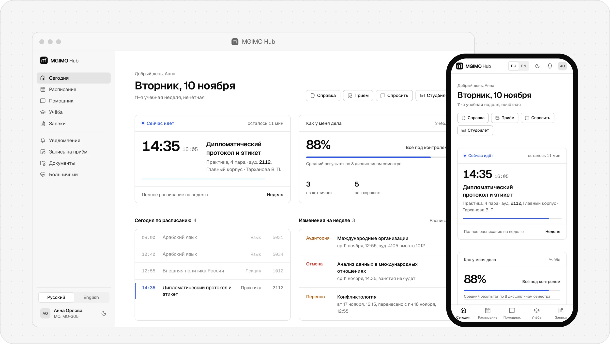
</picture>

</div>

Студент открывает кабинет и сразу видит, куда идти, что изменилось в расписании, что сдать и что уже готово. Справка заказывается в одно касание, статус заявки виден как у посылки. Сотрудник учебного офиса обрабатывает заявку в своей очереди, а студент узнаёт о каждом шаге.

Кабинет работает на телефоне от 360 px, ставится на главный экран, открывает расписание без интернета, переключается между светлой и тёмной темой, русским и английским языком.

| 11 | 8 | 7 | 46 из 46 | 79 |
|:---:|:---:|:---:|:---:|:---:|
| разделов для студента | разделов для учебного офиса | сценариев ИИ | проверок безопасности | e2e-проверок пройдено |

> Прототип для хакатона «Цифровой деканат будущего». Это не официальный сервис МГИМО: все люди, оценки и документы вымышлены, логотип университета не используется, у продукта свой знак.

<div align="center">

[Демо](#демо) · [Что решает](#что-решает) · [Студент](#кабинет-студента) · [Учебный офис](#кабинет-учебного-офиса) · [Атташе](#атташе) · [Архитектура](#архитектура) · [Безопасность](#безопасность) · [Сделано с ИИ](#как-это-сделано-с-ии) · [Запуск](#запуск)

</div>

## Демо

Прототип открыт по адресу **[34-88-153-35.sslip.io](https://34-88-153-35.sslip.io)**. На странице входа тестовые аккаунты открываются в одно касание.

| Кто | Логин | Пароль | Что посмотреть |
|---|---|---|---|
| Анна, МО, 3 курс | `student.anna` | `Demo-Anna-26` | переносы пар, справка с QR |
| Тимур, МЭО, 2 курс | `student.timur` | `Demo-Timur-26` | долг, пересдача, оплата |
| Лейла, ФЛМК, 1 курс | `student.leyla` | `Demo-Leyla-26` | пустые состояния |
| Студенческий офис | `staff.office` | `Demo-Office-26` | очередь всех факультетов |
| Учебный офис МЭО | `staff.meo` | `Demo-Meo-26` | только свой факультет |

**Маршрут на пять минут**

1. Войдите как `student.anna`. На экране «Сегодня» видно, какая пара идёт, где сменилась аудитория, ближайшие дедлайны и статус справки для посольства.
2. Откройте «Учёбу» и карточку любой дисциплины: фраза «как у меня дела», рейтинг и калькулятор «сколько нужно на экзамене».
3. В разделе «Помощник» напишите Атташе: «нужна справка для визы в Италию». Он ответит по вашим данным и подготовит черновик заявки.
4. Отправьте справку об обучении из «Заявок»: форма уже заполнена из профиля, сразу видны статус, срок и этапы.
5. Выйдите и войдите как `staff.office`. Заявка Анны в очереди: «Взять в работу», «Начать подготовку» и «Сформировать справку с QR». У Анны после каждого шага появляется уведомление, а в конце готовый документ.
6. Отсканируйте QR на справке или откройте `/verify/<код>`: подлинность проверяется без входа.
7. Подставьте в адрес чужой номер заявки. Ответ «страница не найдена»: чужие данные не открываются.

## Что решает

Перед разработкой мы изучили отзывы студентов, статьи о цифровизации вузов и чужие личные кабинеты ([исследования](docs/research/)). Учёба разбросана по пяти местам, а за справкой приходится идти ногами. Каждое решение в продукте отвечает на конкретную находку.

| Что болит | Что сделано | Где в продукте |
|---|---|---|
| Каждый день открывают только расписание, главная страница кабинетов пустует | Главный экран отвечает на вопрос «куда идти, что изменилось, что сдать» | «Сегодня» |
| Справку ищут не там, где она лежит | Заказ в одно касание, названия словами студента, данные подставляются из профиля | «Заявки», кнопка «Справка» на главной |
| Запросы в деканат теряются, статус непонятен | Статус как у посылки: этапы, срок, ответственный, история и уведомление на каждом шаге | Карточка заявки, очередь офиса |
| Балльно-рейтинговая система непрозрачна | Одна фраза «как у меня дела» и калькулятор «что если» | «Учёба» |
| О переносах и заменах узнают последними | Изменения подсвечены «было / стало», уведомление получает вся группа | «Расписание» |
| Первокурсники не знают, к кому идти | ИИ-ассистент как первая линия, отвечает по своим данным студента | «Помощник» |
| Расписание не открыть в метро, иностранцам сложно по-русски | Приложение на телефоне с офлайн-режимом и английский интерфейс | PWA, переключатель языка |

Дополнительные разделы выбраны по одному правилу: **что сегодня заставляет студента идти в деканат ногами.** Так появились запись на приём, «Я заболел», все справки с QR в одном месте, оплата для договорников и пересдачи одним действием.

## Кабинет студента

<table>
<tr>
<td width="50%" valign="top">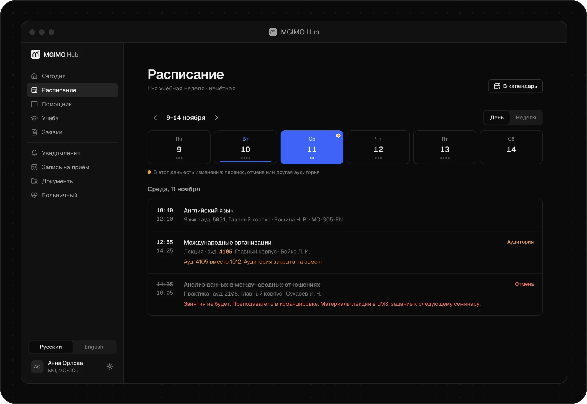<br><b>Расписание</b><br>Перенос, отмена и другая аудитория видны сразу, с причиной. День и неделя, экспорт в календарь телефона.</td>
<td width="50%" valign="top">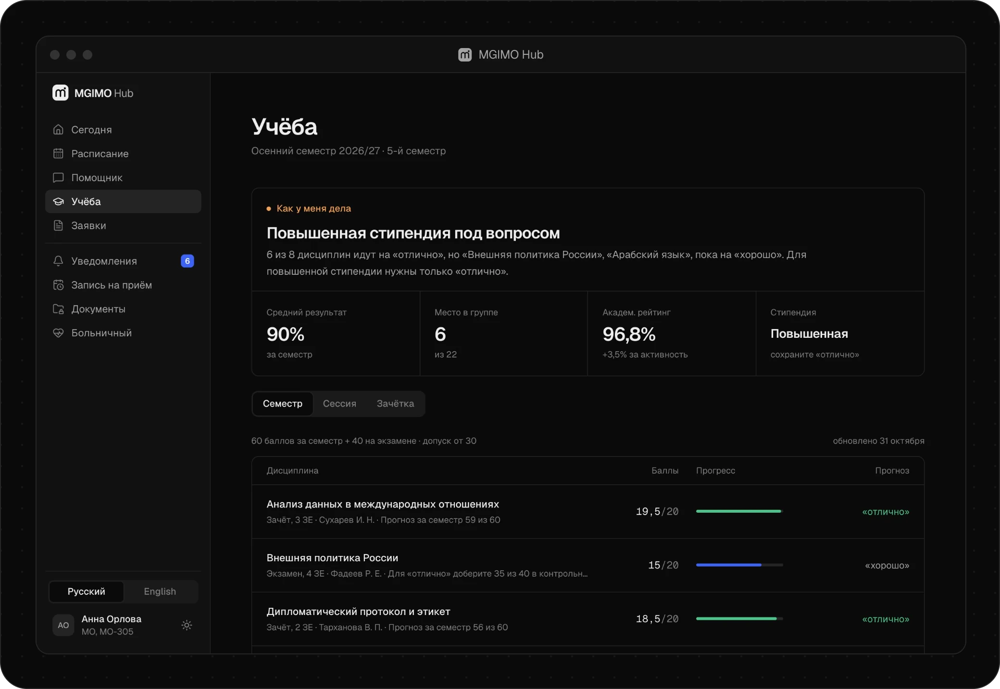<br><b>Учёба</b><br>Баллы по контрольным точкам, прогноз, рейтинг в группе, стипендия и калькулятор «что если».</td>
</tr>
<tr>
<td valign="top">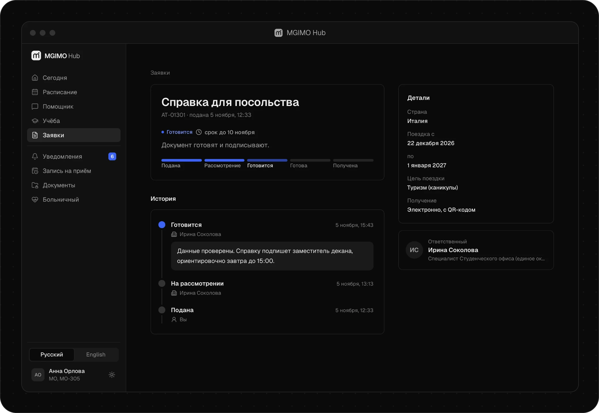<br><b>Заявки</b><br>11 справок и заявлений. Статус как у посылки: этапы, срок, ответственный, история и переписка с офисом.</td>
<td valign="top">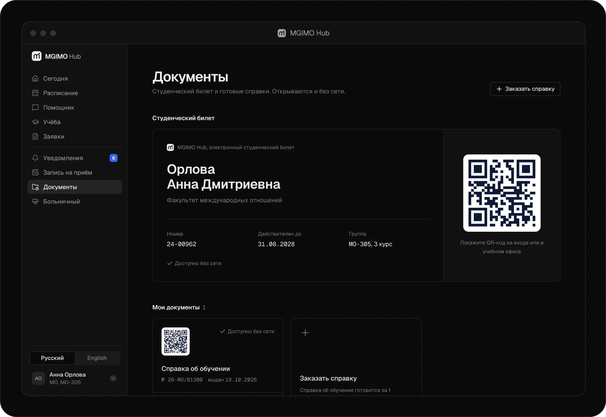<br><b>Документы</b><br>Электронный студенческий и все готовые справки с QR на одной странице. Открываются без интернета.</td>
</tr>
</table>

<div align="center">
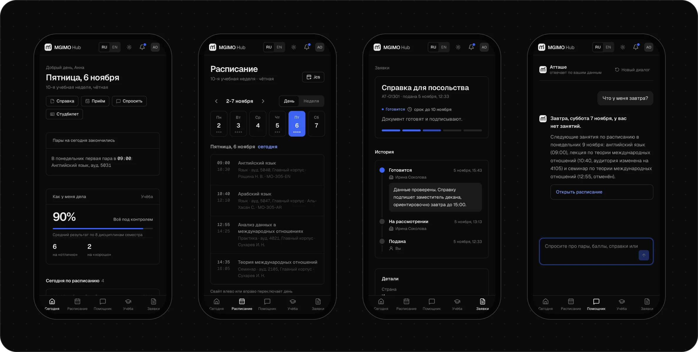
</div>

Всё перечисленное работает на телефоне: кабинет ставится на главный экран, показывает сохранённые расписание, баллы и документы без сети и присылает push-уведомления.

<details>
<summary><b>Все 11 разделов</b></summary>
<br>

| Раздел | Что внутри |
|---|---|
| **Сегодня** | текущая или следующая пара с таймером, изменения в расписании, дедлайны с отметкой «сделано», активные заявки, «как у меня дела», новости |
| **Расписание** | день и неделя, свайп между днями, чётность недели, переносы, отмены, замены и смена аудитории, экспорт в календарь (`.ics`) |
| **Учёба** | баллы по контрольным точкам и прогноз, калькулятор «что если», сессия и допуск, задолженности, зачётка, рейтинг и место в группе, стипендия, «сообщить об ошибке в оценке» |
| **Заявки** | каталог из 11 справок и заявлений с поиском, формы с автоподстановкой, трекер статуса, ответственный и история, диалог с офисом |
| **Помощник** | Атташе: ответы по своему расписанию, баллам и правилам, черновики заявок и писем |
| **Уведомления** | адресно по факультету, курсу и группе, фильтры, «прочитать все», push на телефон |
| **Запись на приём** | тема, день и свободное время вместо живой очереди, талон с кодом и QR, добавление в календарь, отмена |
| **Документы** | электронный студенческий и все готовые справки с QR |
| **Больничный** | сообщить в день болезни, увидеть затронутые пары и контрольные, письмо преподавателю от Атташе, закрыть больничный фото или PDF справки |
| **Оплата** | для студентов на договоре: ближайший платёж, график, квитанция для печати, напоминания (только показ, без платежей) |
| **Профиль** | учебные данные, часы работы офиса, маскирование персональных данных, активные сеансы, язык и тема |

Английский язык включается в кабинете студента, на странице входа и на странице проверки справки. Переводятся интерфейс, новости, уведомления и имена (латиницей). Официальные бланки остаются на русском.

</details>

## Кабинет учебного офиса

<table>
<tr>
<td width="50%" valign="top">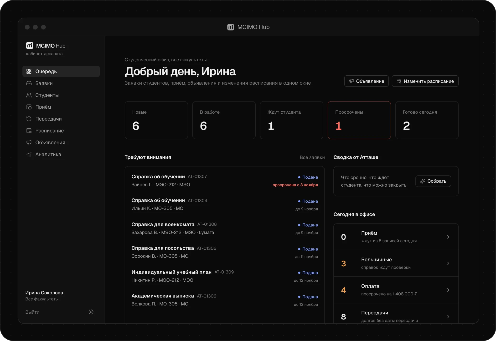<br><b>Очередь</b><br>Новые, в работе, ждут студента и просроченные. Сводку очереди готовит Атташе.</td>
<td width="50%" valign="top">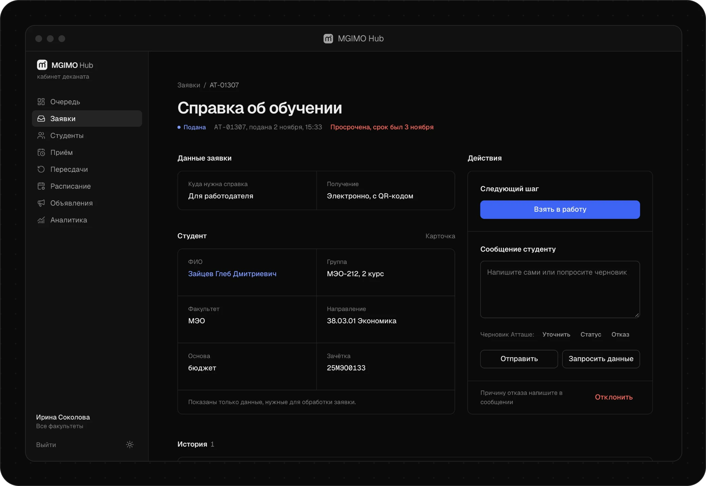<br><b>Заявка</b><br>Взять в работу, запросить уточнение, сформировать справку с QR или отказать. Черновик ответа пишет Атташе.</td>
</tr>
<tr>
<td valign="top">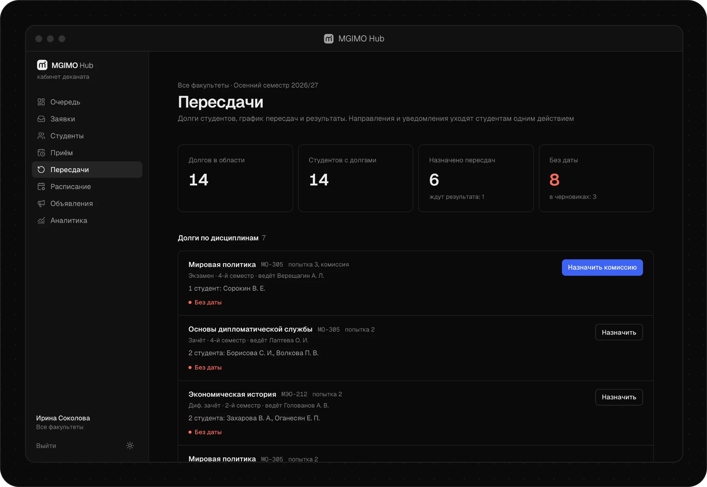<br><b>Пересдачи</b><br>Долги по дисциплинам, подбор даты без пересечения с парами, направления и уведомления одним действием.</td>
<td valign="top">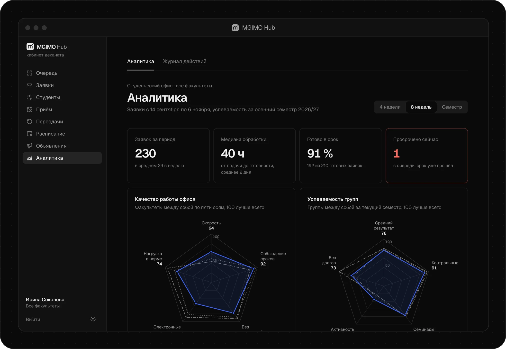<br><b>Аналитика</b><br>Сроки обработки, объём заявок по неделям, нагрузка по часам, успеваемость групп.</td>
</tr>
</table>

Каждое действие сотрудника уведомляет студента и попадает в журнал, записи которого нельзя изменить или удалить. Сотрудник факультета видит только свой факультет, студенческий офис видит все.

<details>
<summary><b>Все 8 разделов</b></summary>
<br>

| Раздел | Что внутри |
|---|---|
| **Очередь** | метрики (новые, в работе, ждут студента, просрочены), «Требуют внимания», сводка от Атташе, приёмы на сегодня |
| **Заявки** | обработка заявок, выдача справки в офисе без заявки студента, проверка больничных |
| **Студенты** | карточка студента на одном экране, риски (долги, угроза допуска, низкие баллы) с причинами и сообщением от Атташе, должники по оплате |
| **Приём** | день приёма с отметками о визите |
| **Пересдачи** | долги по дисциплинам, подбор даты и свободной аудитории, направления, внесение результатов |
| **Расписание** | перенос, отмена, другая аудитория, возврат; студенты группы узнают сразу |
| **Объявления** | для всего университета, факультета, курса или группы, предпросмотр уведомления, перевод на английский после публикации |
| **Аналитика** | качество работы офиса, успеваемость групп, журнал действий сотрудников |

</details>

## Атташе

<table>
<tr>
<td width="55%" valign="top">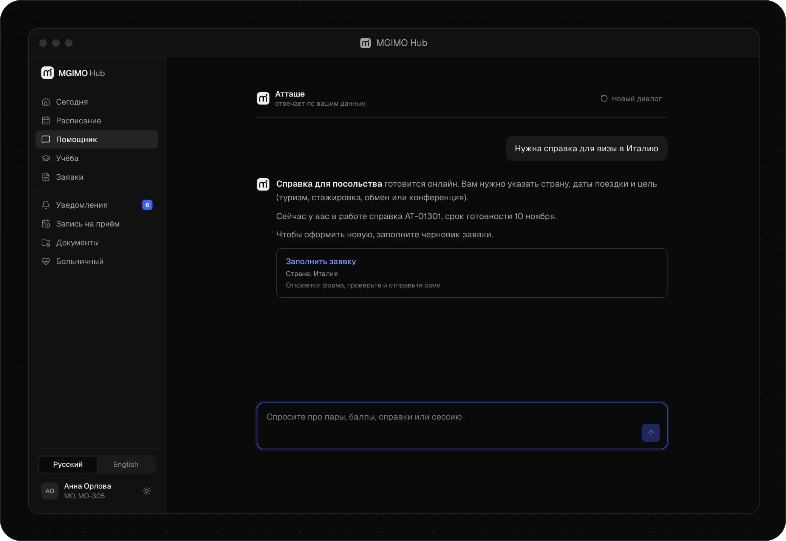</td>
<td valign="top">

В дипломатии атташе берёт рутину на себя. Здесь он превращает фразу «нужна справка для визы в Италию» в готовый черновик заявки. Отправляет её всегда сам студент.

**Семь сценариев**

- ответы про пары, баллы, сессию и справки
- черновик заявки из обычной фразы
- письмо преподавателю при болезни
- черновик ответа студенту для офиса
- сводка очереди заявок
- сообщение студенту в зоне риска
- перевод объявления на английский

</td>
</tr>
</table>

**Почему ассистент не может навредить**

- **Только свои данные.** В запрос к модели попадают данные текущего студента и ничего лишнего: без телефона, почты, даты рождения и номера зачётки.
- **Белый список действий.** Модель возвращает ответ и предложенные действия. Сервер проверяет каждое: тип заявки, значения полей, свои дисциплины, только внутренние ссылки.
- **Работает без модели.** Без ключа или при сбое API включается режим на правилах, демо не ломается.
- **Ключ только на сервере.** Модель вызывается из `src/lib/assistant`, ключ живёт в переменных окружения и не попадает в браузер.
- **Лимит на пользователя.** Место в лимите занимается до обращения к модели, поэтому пачка параллельных запросов не тратит бюджет сверх лимита.

Модель: DeepSeek V3.2 в Amazon Bedrock или прямой API DeepSeek. Проверка подключения: `npm run ai:check`.

## Архитектура

Один сервер Next.js без состояния и PostgreSQL. Сеансы, лимиты входа и лимиты ИИ хранятся в базе, а не в памяти процесса.

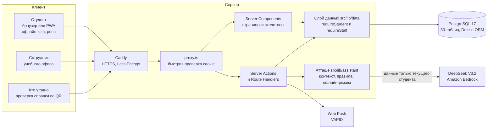

**Путь одной справки от заказа до проверки**

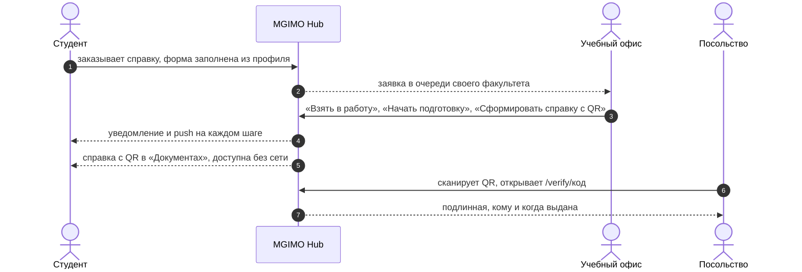

| Слой | Технология и почему |
|---|---|
| Интерфейс | Next.js 16 (App Router), React 19, TypeScript strict, Tailwind CSS 4, свои UI-компоненты без библиотеки |
| Серверная часть | Server Components и Server Actions в том же Next.js: меньше движущихся частей, проверка прав рядом с данными |
| Данные | PostgreSQL 17 и Drizzle ORM: 30 таблиц, 7 миграций, чистый TypeScript без бинарного движка |
| Доступ к данным | запросы страниц собраны в `src/lib/data`, каждый начинается с `requireStudent()` или `requireStaff()` и фильтрует по id из сеанса |
| Вход | argon2id, случайный токен 256 бит в httpOnly-cookie, в базе только SHA-256 токена |
| Проверка ввода | zod на каждом входе: формы, API, ответы модели |
| ИИ | DeepSeek V3.2, только с сервера; перевод объявлений идёт в фоне и не задерживает публикацию |
| Телефон | PWA со своим service worker: расписание, баллы и документы без сети, Web Push |
| Время | всё по Москве через `src/lib/time.ts`, независимо от часового пояса сервера |
| Развёртывание | Docker Compose: база, приложение, Caddy; миграции и демо-данные применяются при старте контейнера |

## Безопасность

Подробная модель угроз: [docs/SECURITY.md](docs/SECURITY.md).

- **Студент видит только своё.** Идентификатор берётся из сеанса, а не из адреса. Чужая заявка, справка, дисциплина или новость отдают 404, чтобы не подтверждать даже существование записи.
- **Сотрудник видит только свой факультет.** Студенческий офис видит все.
- **Пароли и сеансы.** В базе только хэши argon2id и хэш токена сеанса. Cookie с флагами `HttpOnly` и `SameSite=Lax`.
- **Каждое действие проверяет права заново.** Server Action и Route Handler сами проверяют сеанс и роль. Проверка в интерфейсе защитой не считается.
- **Перебор паролей.** Пять неудачных попыток блокируют вход с этого адреса на 15 минут. Чужой аккаунт так заблокировать нельзя: блокировка считается по паре «логин и адрес».
- **Заголовки и запросы.** CSP, `X-Frame-Options`, HSTS, проверка Origin у API, переход после входа только на свои страницы.
- **Целостность.** Двойную запись на одно время приёма отсекает уникальный индекс. Файл справки о болезни проверяется по сигнатуре и отдаётся в песочнице.
- **Журнал только дописывается.** Изменение и удаление записей запрещены триггером PostgreSQL.
- **Телефон.** Офлайн-кэш и переписка с Атташе стираются при выходе. В push-уведомлениях нет оценок и личных подробностей.

Всё это проверяется автоматически: `npm run test:security`, 46 из 46.

## Как это сделано с ИИ

Весь код, тексты, дизайн-система, тесты и развёртывание сделаны ИИ-агентами в Claude Code. Человек ставил задачи, принимал продуктовые и визуальные решения и проверял результат.

| ~16 часов | 34 ИИ-агента | 29 тыс. строк | 230 адресов |
|:---:|:---:|:---:|:---:|
| от ТЗ до сайта по ссылке | 2 исследователя, 10 разработчиков разделов, 22 в оркестрации QA | TypeScript, весь код написан ИИ | автоматический обход: три ширины, две темы, два языка |

- **[Описание процесса для жюри, PDF, 19 страниц](docs/MGIMO-Hub-process.pdf).** Инструменты, ключевые постановки задач, задания субагентам, ошибки ИИ и как их ловили, удачные и неудачные варианты.
- **[Журнал процесса](docs/PROCESS.md).** Все этапы, решения и исправленные ошибки ИИ.
- **[Ролик](video/README.md).** Тоже собран кодом: скрипт проходит по живому кабинету как человек и снимает экран, монтаж и титры описаны в Remotion. Готовый файл лежит в [релизе v1.0](https://github.com/dudlecode/mgimo-hub/releases/tag/v1.0).
- **Документы для агентов.** [CLAUDE.md](CLAUDE.md), [PRD](docs/PRD.md), [дизайн-система](docs/DESIGN.md), [безопасность](docs/SECURITY.md), [исследования](docs/research/).

Инструменты: Claude Code с субагентами и оркестрацией, Playwright для тестов и скриншотов, DeepSeek V3.2 в Amazon Bedrock внутри продукта, Docker, Google Cloud, Caddy и Let's Encrypt для выпуска.

## Запуск

Нужны Node.js 20.9 или новее и Docker.

```bash
cp .env.example .env
npm install
docker compose up -d db
npm run db:migrate && npm run db:seed
npm run dev
```

Откройте http://localhost:3000. Без ключа ИИ Атташе отвечает в режиме на правилах, всё остальное доступно полностью.

| Команда | Что делает |
|---|---|
| `npm run db:reset` | пересоздаёт базу с демо-данными на текущую неделю |
| `npm run typecheck && npm run lint` | проверка типов и линтер |
| `npm run test:security` | 46 проверок изоляции данных против запущенного сервера |
| `npm run test:e2e` | e2e-сценарии Playwright |
| `npm run ai:check` | проверка подключения к модели, ключ не выводится |
| `npm run report` | собирает PDF с описанием процесса |
| `npm run readme:images` | пересобирает картинки этого README с запущенного сервера |

## Развёртывание

Подойдёт любой сервер с Docker. Демо-сервер стоит в Google Cloud (Финляндия) и открывается из России и Казахстана без VPN.

```bash
cp .env.example .env    # задайте свой POSTGRES_PASSWORD и, по желанию, ключ ИИ
docker compose --profile prod up -d --build
```

При старте контейнер сам применяет миграции и заполняет пустую базу демо-данными. Приложение слушает порт `3000`, база наружу не открыта.

**HTTPS одной командой.** Задайте в `.env` переменную `DOMAIN` (свой домен или адрес вида `34-88-153-35.sslip.io`, который работает без регистрации домена), `APP_PORT=127.0.0.1:3000` и `COOKIE_SECURE=true`. Откройте порты 80 и 443. Caddy сам получит сертификат Let's Encrypt:

```bash
docker compose -f docker-compose.yml -f docker-compose.https.yml --profile prod up -d --build
```

HTTPS нужен не только для защиты: без него браузер не включит офлайн-режим, установку на телефон и push-уведомления.

<details>
<summary><b>Переменные окружения</b></summary>
<br>

| Переменная | Назначение |
|---|---|
| `DATABASE_URL` | строка подключения к PostgreSQL (в compose собирается автоматически) |
| `POSTGRES_PASSWORD` | пароль базы. На сервере обязательно задайте свой |
| `AI_PROVIDER` | `bedrock` или `deepseek`. Если не задан, провайдер выбирается по тому, какой ключ указан |
| `AWS_REGION`, `BEDROCK_MODEL_ID` | по умолчанию `us-east-1` и `deepseek.v3.2` |
| `AWS_BEARER_TOKEN_BEDROCK` | API-ключ Bedrock, либо пара `AWS_ACCESS_KEY_ID` и `AWS_SECRET_ACCESS_KEY` |
| `DEEPSEEK_API_KEY` | ключ прямого API DeepSeek. Без ключей Атташе отвечает в режиме на правилах |
| `DEMO_MODE` | `false` скрывает блок тестовых аккаунтов на странице входа |
| `SEED_ON_START` | `if-empty` (по умолчанию), `always` (пересоздавать демо-данные при каждом старте) или `never` |
| `COOKIE_SECURE` | `auto`, `true` или `false`. За HTTPS-прокси надёжнее `true` |
| `APP_URL` | публичный адрес для ссылок в QR-кодах. По умолчанию берётся из запроса |
| `DOMAIN` | домен для HTTPS через Caddy |
| `APP_PORT`, `DB_PORT` | порты на сервере. База по умолчанию слушает только `127.0.0.1:5433` |
| `VAPID_PUBLIC_KEY`, `VAPID_PRIVATE_KEY`, `VAPID_SUBJECT` | ключи Web Push (`npx web-push generate-vapid-keys`). Без них push выключен, остальное работает |

Демо-данные строятся относительно текущей даты: текущая неделя, ближайшие дедлайны, свежие переносы. Перед показом их стоит обновить командой `docker compose exec app node scripts/seed.js`. Она пересоздаёт все данные, включая заявки, созданные в демо.

</details>

## Тесты и качество

| Что | Результат |
|---|---|
| Проверки безопасности, `npm run test:security` | **46 из 46** |
| E2E, 40 сценариев на ширине 1280 и 360 px | **79 пройдено**, 1 пропущен намеренно |
| `tsc`, `eslint`, `next build` | без ошибок и предупреждений |

Оба набора работают против запущенного сервера на демо-данных и подключаются к той же базе, чтобы подготовить и убрать за собой тестовые записи. Тесты, которые меняют данные, откатывают созданное, поэтому их можно гонять повторно.

```bash
E2E_BASE_URL=http://localhost:3000 npm run test:e2e   # по умолчанию тесты ждут сервер на :3001
npx playwright test tests/e2e/smoke.spec.ts           # одна спека
```

<details>
<summary><b>Что проверяет каждая спека</b></summary>
<br>

| Спека | Что проверяет |
|---|---|
| `smoke` | все пункты меню трёх студентов на русском и английском и обоих сотрудников: нет ошибок страницы и консоли, на 360 px нет горизонтальной прокрутки |
| `student-core` | вход, оболочка, «Сегодня», расписание, учёба и калькулятор, профиль и сеансы |
| `student-services` | заказ справки и отзыв, справка с QR и `/verify`, уведомления, Атташе с черновиком заявки, английский интерфейс |
| `service-flows` | запись на приём, больничный со справкой, оплата и напоминания |
| `staff-core` | полный путь заявки до выдачи справки, уточнение и отказ, объявления, расписание, карточка студента и журнал, видимость только своего факультета |
| `staff-insights` | риски студентов, аналитика, пересдачи и направление у студента |

Для e2e нужен установленный Google Chrome: Playwright берёт системный браузер и не скачивает свой.

</details>

У каждого списка и раздела есть скелетон загрузки, пустое состояние и экран ошибки с повтором. Страницы одной записи (заявка, дисциплина, талон) намеренно обходятся без скелетона: так несуществующий или чужой адрес получает честный ответ 404.

## Структура проекта

```
src/app/(auth)/login        вход
src/app/(student)/...       кабинет студента
src/app/staff/...           кабинет учебного офиса
src/app/verify/[code]       публичная проверка справки по QR
src/app/api/...             ассистент, календарь .ics, push, файлы больничных, health
src/proxy.ts                быстрая проверка cookie сеанса
src/lib/auth                сеансы, вход, лимиты, requireStudent и requireStaff
src/lib/data                запросы к базе с проверкой владельца
src/lib/assistant           контекст, правила, провайдеры модели, офлайн-режим
src/lib/requests            каталог справок и заявлений, коды проверки
src/lib/i18n                русский и английский, транслитерация имён
src/components              свои UI-компоненты, оболочка, графики, PWA
src/db                      схема, подключение, генератор демо-данных
drizzle/                    миграции
scripts/                    проверки безопасности, проверка ИИ, сборка отчёта
tests/e2e                   сценарии Playwright
docs/                       PRD, дизайн, безопасность, журнал процесса, исследования, отчёт
deploy/Caddyfile            HTTPS для docker-compose.https.yml
video/                      ролик: запись кабинета (Playwright) и монтаж (Remotion)
```

## Лицензии сторонних материалов

Next.js, React, Tailwind CSS и motion распространяются по лицензии MIT, Lucide по ISC, Drizzle ORM по Apache 2.0, web-push по MPL 2.0. Шрифты Geist и Geist Mono распространяются по SIL Open Font License. Музыка в ролике из библиотеки Mixkit (лицензия Mixkit Free), ролик собран в Remotion (бесплатная лицензия для частных лиц).

Изображения сторонних авторов не используются: знак продукта, анимация на странице входа и иконки нарисованы в коде, картинки нейросетью не генерировались.
